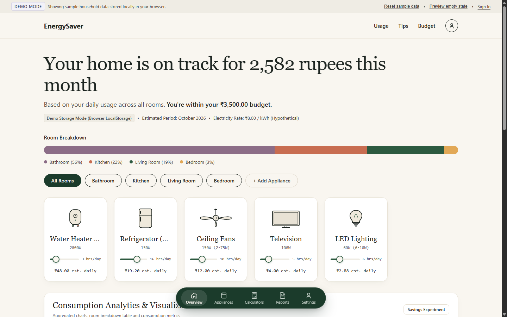
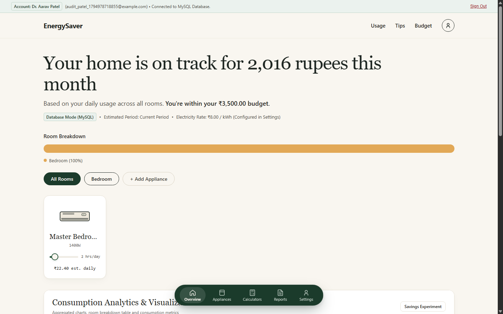
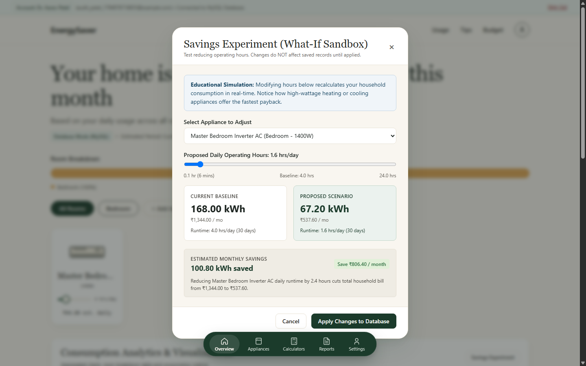
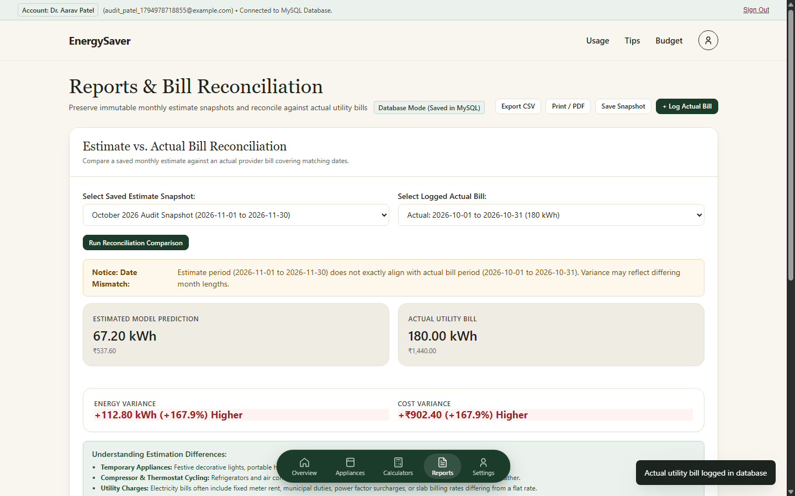
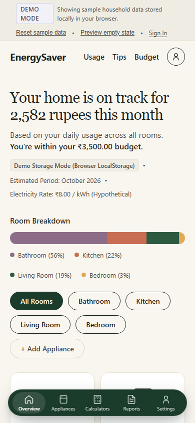
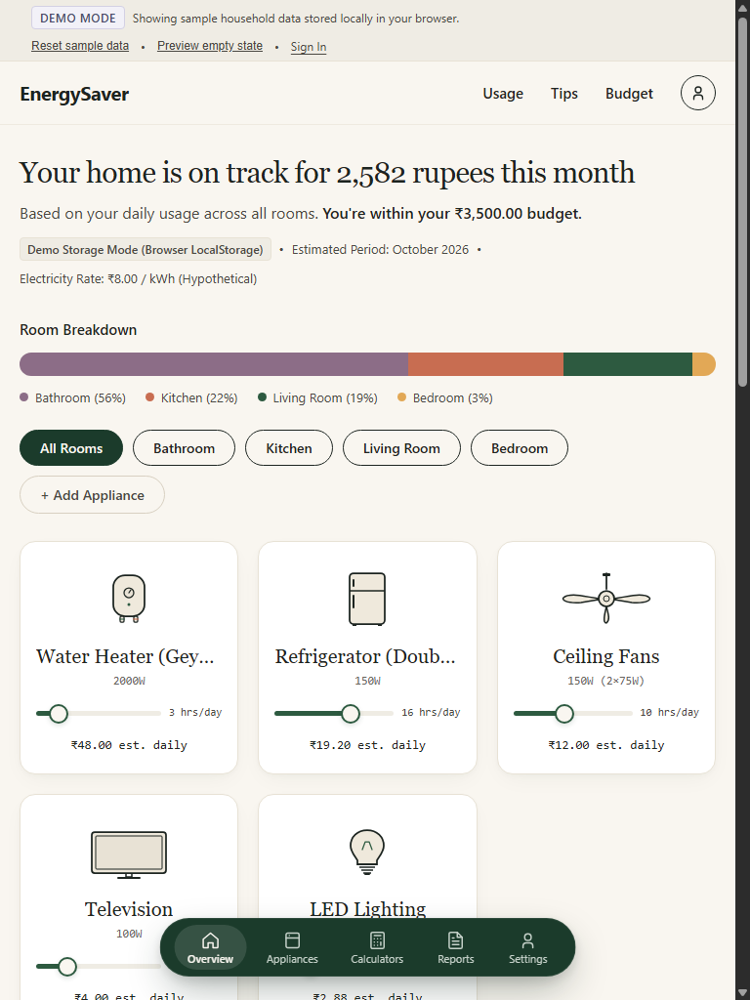

# EnergySaver — Electricity Usage Analyzer

> **A full-stack electricity usage analysis and savings planning platform built with Vanilla JavaScript, Node.js, Express, and MySQL.**  
> **Academic Capstone Software Engineering Project**  
> **Target Environment:** Node.js LTS (v18+/v20+), Express.js 4.19, MySQL 8.0+, Semantic HTML5 / Vanilla CSS3 / ES6+ JavaScript  

---

## 1. Project Overview

In residential utility billing, consumers typically receive a single monthly bill detailing only their total electrical energy consumed (in kilowatt-hours / units) and the total billed amount. That single aggregate number provides zero visibility into which specific appliances—such as air conditioners, refrigerators, water heaters, ceiling fans, or home entertainment electronics—are driving consumption.

**EnergySaver** is an educational household energy modeling and budgeting platform that bridges this gap:
- **Appliance-Level Granularity:** Inventories appliances by rated wattage, quantity, daily usage hours, and monthly operating days.
- **Authoritative Mathematical Modeling:** Server-side physics calculations determine daily and monthly consumption (kWh) alongside financial costs.
- **Interactive Visualizations:** Overview dashboard featuring an editorial room breakdown progress bar, category filter pills, appliance cards, and responsive Chart.js data visualizations.
- **What-If Scenario Sandbox:** Interactive savings simulator modeling prospective runtime schedule adjustments without altering baseline persistent records.
- **Immutable Historical Snapshots:** Freezes monthly estimation snapshots alongside historical tariffs, appliance inventories, and calculation metadata.
- **Utility Bill Reconciliation:** Compares estimated snapshots against physical utility bills, identifying consumption gaps and billing period variances.
- **Dual Operating Modes:** Operates seamlessly in guest demo mode (browser `localStorage`) and authenticated private database mode (MySQL 8.0).

---

## 2. Problem Statement

Residential electricity consumption is one of the largest controllable operational expenses in urban households. However, consumers make uninformed decisions because utility meters only measure the aggregate building electrical feed:
1. Consumers replace low-wattage fixtures (e.g., saving 10W per bulb) while neglecting an unserviced water heater or aging refrigerator compressor consuming thousands of watt-hours.
2. Consumers cannot calculate the exact financial benefit of modifying daily habits before changing their routines.
3. Billing discrepancies, faulty wiring, or phantom loads go unnoticed because consumers lack an independent mathematical baseline.

EnergySaver provides a software-driven energy auditing methodology that requires zero hardware investment, giving households complete transparency over their power consumption.

---

## 3. Key Features

- **User Authentication & Session Management:** User registration, session-based login, password updates, and account deletion with complete relational cascading deletion.
- **Appliance Inventory CRUD:** Add, edit, view, and delete household appliances with instant client preview calculations and authoritative server validation.
- **Editable Presets Catalog:** Pre-configured library of common domestic appliances with standard wattages and educational efficiency badges.
- **Warm Minimalist Editorial Dashboard:** Clean layout displaying monthly on-track costs, segmented room breakdown bar, filter pills, and 6-column appliance grid.
- **Dynamic Budget Monitoring:** Status alerts notifying users when spending is Normal, Approaching Budget ($\ge 80\%$), or Over Budget ($> 100\%$).
- **Tactile Sliders & Zero Silent Commits:** Dragging appliance card sliders provides real-time client feedback without unprompted database commits. Changes require explicit user confirmation.
- **What-If Savings Sandbox:** Simulate runtime reductions to visualize prospective kilowatt-hour and rupee savings before committing changes to MySQL.
- **Historical Report Snapshots:** Save immutable monthly estimation records with frozen appliance lists, historical tariffs, and calculation versions.
- **Actual Bill Reconciliation:** Enter actual electricity bills to compute kilowatt-hour and cost variances, accompanied by an educational diagnostic checklist for unexplained discrepancies.
- **Sanitized CSV Export:** Stream appliance inventory to CSV with spreadsheet formula injection defenses (`'` prefix on formula triggers).
- **Isolated Demo Mode:** Unauthenticated visitors explore a pre-populated 2-BHK apartment scenario in `localStorage` without affecting database tables.

---

## 4. Technology Stack

EnergySaver is built on a clean, single-origin architecture with zero heavy frontend build systems (no Webpack, Vite, or React) to ensure maximum maintainability, transparency, and reproducibility:

| Layer | Technology | Purpose |
|:---|:---|:---|
| **Frontend Markup** | Semantic HTML5 | Accessible, structured page layout with native forms and WCAG 2.1 AA compliant semantics. |
| **Styling & Design System** | Vanilla CSS3 | Custom Warm Minimalist Editorial design system (`editorial-tokens.css`, `base.css`, `components.css`). |
| **Frontend Scripting** | Vanilla JavaScript (ES6+) | Native asynchronous `fetch()`, DOM rendering, event handling, and zero-latency client previews. |
| **Data Visualization** | Chart.js | Local vendor bundle (`chart.umd.min.js`) rendering donut and bar visualizations with 100% offline support. |
| **Backend Monolith** | Node.js & Express.js | Unified Express HTTP server delivering static frontend views and RESTful API endpoints from port 3000. |
| **Relational Database** | MySQL 8.0+ (`mysql2/promise`) | Relational persistence with InnoDB engine, foreign keys, cascade deletes, and 100% parameterized SQL. |
| **Session & Auth** | `express-session`, `express-mysql-session`, `bcrypt` | Cookie-based session store persisted in MySQL (`sessions` table) and salted bcrypt password hashing (10 rounds). |
| **Defensive Security** | Helmet, CSRF Middleware, Rate Limiter | HTTP security headers (CSP, nosniff, frameguard), session-bound CSRF tokens, and IP brute-force protection. |

---

## 5. System Architecture

EnergySaver operates as a single-origin monolith where Express serves static client files and API endpoints from the same origin:

```text
[ Browser Client (HTML5 / Vanilla JS / CSS3) ]
                     |
       HTTP Requests + X-CSRF-Token
                     v
+-------------------------------------------------------------+
|                      Node.js / Express                      |
|                                                             |
|  [Security Middleware]  --> Helmet, Rate Limiter, CSRF       |
|  [Session Middleware]   --> express-session + MySQLStore    |
|  [Static Asset Server]  --> /public (HTML, CSS, JS, Assets) |
|  [REST API Router]      --> /api/auth, /api/appliances,     |
|                             /api/dashboard, /api/savings,   |
|                             /api/reports, /api/settings     |
|  [Calculation Engine]   --> src/services/calculator.js      |
+-------------------------------------------------------------+
                     |
        Parameterized SQL via mysql2/promise
                     v
+-------------------------------------------------------------+
|                      MySQL 8.0 Database                     |
|                                                             |
|  users               --> User credentials & bcrypt hashes   |
|  user_settings       --> Tariff rate, currency, budget      |
|  appliances          --> Appliance specs, hours, days       |
|  report_snapshots    --> Frozen monthly snapshot headers    |
|  report_snapshot_items-> Frozen appliance line items        |
|  actual_bills        --> Utility bills for reconciliation   |
|  sessions            --> express-session persistent store   |
+-------------------------------------------------------------+
```

---

## 6. Screenshots

The user interface follows the **Option B: Warm Minimalist Editorial Design System**:

| Screen | Viewport | Preview |
|:---|:---:|:---|
| **Overview Dashboard** | Desktop (1440px) |  |
| **Tactile Slider Preview** | Desktop (1440px) |  |
| **What-If Savings Sandbox** | Desktop (1440px) |  |
| **Bill Reconciliation** | Desktop (1440px) |  |
| **Mobile Responsive View** | Smartphone (390px) |  |
| **Tablet Viewport** | Tablet (768px) |  |

---

## 7. Project Structure

```text
EnergySaver/
│
├── public/                 # Static frontend assets served by Express
│   ├── css/                # Custom CSS design system & editorial tokens
│   │   ├── base.css
│   │   ├── components.css
│   │   ├── editorial-theme.css
│   │   ├── editorial-tokens.css
│   │   ├── print.css
│   │   └── variables.css
│   ├── js/                 # Client JavaScript modules
│   │   ├── components/     # UI components (illustrations, floating navigation)
│   │   ├── utils/          # Client helpers (calculator preview, formatters, presets)
│   │   ├── vendor/         # Offline bundled third-party libraries (Chart.js)
│   │   ├── api.js          # Central fetch gateway & CSRF handler
│   │   ├── appliances.js   # Appliance inventory controller
│   │   ├── auth.js         # Authentication form controller
│   │   ├── dashboard.js    # Overview dashboard controller
│   │   ├── nav.js          # Navigation bar & mode badge controller
│   │   ├── reports.js      # Snapshots & bill reconciliation controller
│   │   ├── savings-modal.js# What-If scenario sandbox controller
│   │   ├── settings.js     # User profile & tariff settings controller
│   │   └── storage.js      # Guest demo mode storage controller
│   ├── index.html          # Overview Dashboard page
│   ├── appliances.html     # Appliance Inventory page
│   ├── reports.html        # Historical Reports & Reconciliation page
│   ├── settings.html       # User Profile & Settings page
│   ├── login.html          # Account Sign In page
│   └── register.html       # Account Registration page
│
├── src/                    # Node.js Express backend source code
│   ├── config/             # Environment & MySQL connection pool setup
│   ├── controllers/        # Express route business logic controllers
│   ├── middleware/         # Auth guard, CSRF protection, rate limits, error handling
│   ├── scripts/            # CLI database health check and schema init scripts
│   ├── services/           # Authoritative mathematical calculation engine
│   ├── app.js              # Express app factory & middleware stack
│   └── server.js           # Production server entry point & graceful shutdown
│
├── sql/                    # Relational database scripts
│   ├── schema.sql          # MySQL 8.0 DDL schema (7 tables, foreign keys, constraints)
│   └── seed.sql            # Sample 2-BHK apartment seed dataset
│
├── docs/                   # Architectural guides, API specs, and viva documentation
│   ├── screenshots/        # Showcase interface screenshots for public display
│   ├── API_SPEC.md
│   ├── ARCHITECTURE.md
│   ├── CALCULATIONS.md
│   ├── DATABASE.md
│   ├── DEMO_GUIDE.md
│   ├── DEPLOYMENT.md
│   ├── DEVELOPMENT_PHASES.md
│   ├── FEATURES.md
│   ├── GITHUB_PUBLICATION_CHECKLIST.md
│   ├── PRD.md
│   ├── SECURITY.md
│   ├── TEST_PLAN.md
│   ├── UI_UX.md
│   ├── USER_FLOWS.md
│   ├── ENERGYSAVER_API_AND_DATABASE_GUIDE.md
│   ├── ENERGYSAVER_COMPLETE_CODEBASE_HANDBOOK.md
│   ├── ENERGYSAVER_FUNCTION_INDEX.md
│   ├── ENERGYSAVER_LAST_MINUTE_REVISION.md
│   ├── ENERGYSAVER_ONE_DAY_STUDY_PLAN.md
│   └── ENERGYSAVER_VIVA_QUESTION_BANK.md
│
├── .env.example            # Safe environment variable configuration template
├── .gitignore              # Git exclusion rules
├── .gitattributes          # Line ending normalization rules (LF)
├── .nvmrc                  # Node.js target version specification (20)
├── package.json            # Dependencies and npm scripts
└── README.md               # Primary project documentation
```

---

## 8. Installation Requirements

To install and run EnergySaver locally, ensure you have:
- **Node.js:** `v18.0.0` or higher (`v20.x` LTS recommended).
- **npm:** `v9.0.0` or higher.
- **MySQL Server:** `v8.0` or higher running locally or accessible via network.
- **Web Browser:** Any modern evergreen browser (Google Chrome, Mozilla Firefox, Microsoft Edge, Safari).

---

## 9. Local Installation

1. **Clone the repository:**
   ```bash
   git clone https://github.com/your-username/EnergySaver.git
   cd EnergySaver
   ```

2. **Install production dependencies:**
   ```bash
   npm install
   ```

3. **Configure Environment Variables:**
   Copy the example environment template:
   ```bash
   cp .env.example .env
   ```
   Edit `.env` to supply your local MySQL database credentials:
   ```ini
   DB_HOST=127.0.0.1
   DB_PORT=3306
   DB_USER=root
   DB_PASSWORD=your_mysql_password
   DB_NAME=energysaver_db
   SESSION_SECRET=a_strong_random_secret_at_least_32_characters_long
   ```

---

## 10. Database Setup

1. **Ensure MySQL is running:**
   ```bash
   mysql -u root -p -e "CREATE DATABASE IF NOT EXISTS energysaver_db CHARACTER SET utf8mb4 COLLATE utf8mb4_unicode_ci;"
   ```

2. **Initialize Database Tables:**
   Execute the automated schema initialization script:
   ```bash
   npm run db:init
   ```
   *(Alternatively, manually import `sql/schema.sql` and `sql/seed.sql` using MySQL Workbench or CLI).*

3. **Verify Database Connectivity:**
   ```bash
   npm run db:check
   ```
   You should see: `[DB CHECK] MySQL database connection verified.`

---

## 11. Environment Variables

All configuration is managed through environment variables loaded via `dotenv`:

| Variable | Type | Default | Description |
|:---|:---:|:---:|:---|
| `NODE_ENV` | String | `development` | Runtime environment (`development` or `production`). |
| `PORT` | Integer | `3000` | Port for the HTTP server. |
| `TRUST_PROXY` | Boolean | `false` | Enable reverse proxy header evaluation (e.g., Nginx, Cloudflare, Render). |
| `DB_HOST` | String | `127.0.0.1` | MySQL server host address. |
| `DB_PORT` | Integer | `3306` | MySQL server port. |
| `DB_USER` | String | `root` | MySQL runtime username. |
| `DB_PASSWORD` | String | *Empty* | MySQL runtime password. |
| `DB_NAME` | String | `energysaver_db` | MySQL database name. |
| `DB_CONNECTION_LIMIT` | Integer | `10` | Maximum connections in the MySQL connection pool. |
| `SESSION_SECRET` | String | *Dev fallback* | Secret string for session cookie signing (minimum 32 chars in production). |
| `SESSION_NAME` | String | `energysaver_sid` | Name of the session cookie. |
| `COOKIE_SECURE` | Boolean | `false` | Set to `true` when serving over HTTPS in production. |
| `SESSION_MAX_AGE_MS` | Integer | `604800000` | Session cookie expiration in milliseconds (7 days). |
| `RATE_LIMIT_WINDOW_MS`| Integer | `900000` | Brute-force rate limit window in milliseconds (15 minutes). |
| `RATE_LIMIT_MAX` | Integer | `5` | Maximum failed login attempts allowed per IP before temporary lockout. |

---

## 12. Running the Application

### Production Mode
```bash
npm start
```
Starts the server at `http://localhost:3000`.

### Development Mode (with Live Reload)
```bash
npm run dev
```
Starts Node.js with built-in `--watch` watching for file modifications.

### Verifying Startup
Open your browser and navigate to:
- **Dashboard:** `http://localhost:3000`
- **Health Check (Liveness):** `http://localhost:3000/health/live`
- **Health Check (Readiness):** `http://localhost:3000/health/ready`

If MySQL is not running, the application starts gracefully in **Guest Demo Mode** (`localStorage`), ensuring zero-friction exploration.

---

## 13. Calculation Methodology

All calculations are executed authoritative server-side in `src/services/calculator.js` (with a matching preview implementation in `public/js/utils/calculator.js` for zero-latency UI rendering):

### Baseline Physics Formulas

1. **Daily Energy Consumption:**
   $$\text{Daily kWh} = \frac{\text{Rated Watts} \times \text{Quantity} \times \text{Daily Hours}}{1000}$$

2. **Monthly Energy Consumption:**
   $$\text{Monthly kWh} = \text{Daily kWh} \times \text{Days Used Per Month}$$

3. **Estimated Monthly Electricity Cost:**
   $$\text{Estimated Monthly Cost} = \text{Monthly kWh} \times \text{Tariff Rate (₹/kWh)}$$

4. **Scenario Delta Savings Calculation:**
   $$\Delta\text{ kWh} = \sum\text{Baseline Monthly kWh} - \sum\text{Proposed Monthly kWh}$$
   $$\Delta\text{ Cost} = \sum\text{Baseline Monthly Cost} - \sum\text{Proposed Monthly Cost}$$

### Intermediate Precision Policy
To prevent cumulative rounding drift (e.g., 1-paisa discrepancies), intermediate calculations retain full IEEE 754 64-bit floating point precision. Scientific exponential half-up rounding (`roundTo`) is applied exclusively at the final presentation boundary:
- **Energy Metrics:** Rounded to 2 decimal places (e.g. `120.45 kWh`).
- **Financial Metrics:** Rounded to 2 decimal places (e.g. `₹963.60`).
- **Percentages:** Rounded to 1 or 2 decimal places as appropriate (e.g. `73.8%`).

---

## 14. Security Overview

EnergySaver adheres strictly to the **OWASP Top 10** defensive guidelines:
- **Authentication:** Salted bcrypt password hashing with a work factor of 10.
- **Session Protection:** Signed cookies configured with `HttpOnly`, `SameSite=Lax`, and dynamic `Secure` flags. Session identifiers regenerate upon registration, login, and privilege changes to prevent session fixation.
- **Cross-Site Request Forgery (CSRF):** State-changing requests (`POST`, `PUT`, `DELETE`) require a cryptographically valid `X-CSRF-Token` verified in constant time (`crypto.timingSafeEqual`).
- **Zero-Trust IDOR Defense:** Every SQL query modifying or reading user-owned records enforces strict user binding (`WHERE user_id = req.session.userId`).
- **SQL Injection Prevention:** 100% of queries execute through parameterized prepared statements via `mysql2/promise`.
- **Brute-Force Rate Limiting:** Sliding rate limiter restricts login attempts to 5 failures per 15 minutes per IP address with automated memory-pruning sweeps.
- **Formula Injection Defense:** CSV export sanitizes spreadsheet formula triggers (`=`, `+`, `-`, `@`) by prepending a safe apostrophe (`'`).

---

## 15. Testing Architecture & Public Scope Note

During academic development, EnergySaver was verified with an exhaustive **371-assertion automated test suite** covering:
- Mathematical precision and boundary conditions (75 assertions).
- Backend infrastructure, static file delivery, and health probes (15 assertions).
- Session-based authentication, password hashing, and cascading deletions (29 assertions).
- Appliance inventory CRUD, input bounds, and IDOR isolation (80 assertions).
- Dashboard metrics, savings simulation, snapshots, and bill reconciliation (96 assertions).
- Defensive security: CSRF, SQL injection, IDOR, brute-force rate limiting, and CSV sanitization (48 assertions).
- Credential management and profile modification (30 assertions).
- Headless Chrome CDP visual and responsive viewport tests across 6 viewports (22 checks).

### Public Repository Scope
To safeguard proprietary examination materials, rubric benchmarks, and academic evaluation criteria, the private test harness files located in `test/` and historical audit logs in `audit/` are retained in the internal development environment and excluded from this public repository distribution.

Developers wishing to implement automated tests for their own forks can add test suites using their preferred test runner (e.g., Jest, Mocha, or Supertest) referencing the npm scripts defined in `package.json`.

---

## 16. Limitations & Educational Scope

- **Rated vs. Actual Consumption:** Calculations utilize manufacturer rated wattages. Real-world consumption may vary based on appliance age, efficiency decay, and operating conditions.
- **Compressor Duty Cycles:** Intermittent cooling loads (refrigerators, inverter air conditioners) cycle on and off via thermostats. Entered daily hours represent effective compressor run-time rather than continuous wall-plug connection.
- **Flat-Rate Electricity Tariffs:** The core release models flat-rate tariffs (₹/kWh). Progressive multi-tiered tariff slabs are planned for future phases.
- **Non-Hardware Integration:** The application does not interface directly with physical IoT smart meters; data entry is managed through user input or sample presets.

---

## 17. Future Improvements (Phase 6 Scope)

The following enhancements are cataloged for future major releases:
- Progressive tiered tariff slab calculation engine with fixed meter charges and regulatory taxes.
- Split weekday versus weekend appliance operating schedules.
- Compressor duty-cycle percentage modeling for intermittent refrigeration loads.
- Standby phantom power tracking without double-counting active hours.
- Appliance replacement payback calculator comparing existing versus 5-star BEE models.
- Household reduction goal tracking linked against saved baseline snapshots.
- JSON backup export and validated restore with duplicate handling.

---

## 18. Credits and Licensing

This application was developed as an academic capstone software engineering project for the **Bachelor of Technology in Computer Science & Engineering (B.Tech CSE)** degree examination (Target Examination Date: 19 November 2026).

**Project Name:** EnergySaver — Electricity Usage Analyzer  
**License:** ISC License — see [package.json](package.json) for details.
