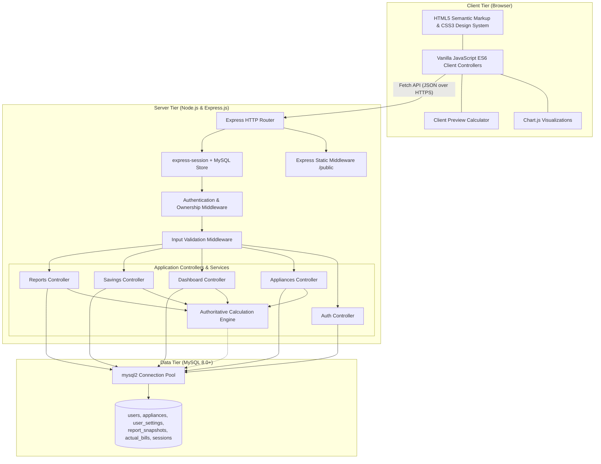
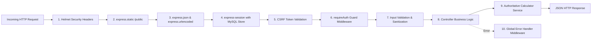

# System Architecture & Technical Design

## Project: EnergySaver – Electricity Usage Analyzer
**Document Version:** 1.0.0  
**Reference Document:** [docs/PRD.md](file:///c:/Users/garvi/OneDrive/Desktop/WEB%20Tech/Ai-project/docs/PRD.md)

---

## 1. Architectural Overview & Design Goals

EnergySaver is architected as a lightweight, monolithic web application using Node.js, Express, and MySQL. It intentionally avoids microservices, complex message queues, and heavy single-page application (SPA) build tools. 

### Core Architectural Goals:
1. **Explainability for Students:** Clear separation of concerns that can be readily defended in a university viva.
2. **Single-Origin Deployment:** Express serves both the static HTML/CSS/JS frontend assets and the `/api` JSON routes from a single unified port, eliminating Cross-Origin Resource Sharing (CORS) complexity.
3. **Authoritative Backend Computation:** All official figures, database saves, and immutable reports are calculated server-side; client-side JavaScript performs instant UI previews using an identical mirrored calculation service.
4. **Zero-Trust User Data Isolation:** Every database query interacting with user data strictly includes `WHERE user_id = ?` derived directly from the authenticated server session.

---

## 2. System Architecture Diagram



---

## 3. Directory & Folder Structure

```
Ai-project/
├── .env.example                 # Template for required environment variables
├── .gitignore                   # Ignores node_modules, .env, and local logs
├── README.md                    # Project overview & documentation index
├── TASKS.md                     # Phase-by-phase actionable implementation checklist
├── AGENTS.md                    # Guidelines for future AI coding agents
├── package.json                 # Node.js project manifest & npm scripts
├── docs/                        # Complete technical and design documentation
│   ├── PRD.md
│   ├── FEATURES.md
│   ├── USER_FLOWS.md
│   ├── UI_UX.md
│   ├── ARCHITECTURE.md
│   ├── DATABASE.md
│   ├── API_SPEC.md
│   ├── CALCULATIONS.md
│   ├── SECURITY.md
│   ├── DEVELOPMENT_PHASES.md
│   ├── TEST_PLAN.md
│   ├── DEPLOYMENT.md
│   └── DEMO_GUIDE.md
├── public/                      # Static client-side assets served by Express
│   ├── index.html               # My Home (Dashboard)
│   ├── appliances.html          # Appliance Inventory & Preset Manager
│   ├── savings.html             # What-If Savings Scenario Planner
│   ├── reports.html             # Reports, Snapshots & Bill Reconciliation
│   ├── settings.html            # Profile, Budget & Electricity Tariff Config
│   ├── login.html               # Login screen
│   ├── register.html            # Registration screen
│   ├── css/
│   │   ├── variables.css        # Color tokens, typography, spacing variables
│   │   ├── base.css             # CSS reset, typography, layout grid
│   │   ├── components.css       # Buttons, cards, modals, tables, forms, badges
│   │   └── print.css            # Clean A4 print stylesheet for reports
│   └── js/
│       ├── api.js               # Centralized fetch wrapper & error handler
│       ├── auth.js              # Session status checker & logout handler
│       ├── dashboard.js         # My Home dashboard logic & Chart.js rendering
│       ├── appliances.js        # Appliance table rendering, search, modals
│       ├── savings.js           # What-If scenario sandbox & delta math
│       ├── reports.js           # Snapshot creation, bill logging, reconciliation
│       ├── settings.js          # Settings forms & account deletion modal
│       └── utils/
│           ├── calculator.js    # Client-side preview calculation mirror
│           ├── formatters.js    # Currency, kWh, and date formatting helpers
│           └── presets.js       # Common appliance presets catalog
├── src/                         # Server-side application code
│   ├── server.js                # Express app initialization & server entry point
│   ├── config/
│   │   ├── database.js          # mysql2 connection pool configuration
│   │   └── constants.js         # Default app constants (presets, limits)
│   ├── middleware/
│   │   ├── auth.js              # Session authentication guard
│   │   ├── validation.js        # Request body and query parameter sanitizers
│   │   ├── rateLimiter.js       # In-memory rate limiter for auth routes
│   │   └── errorHandler.js      # Global error catch-all handler
│   ├── controllers/
│   │   ├── authController.js    # Register, login, logout, profile, deletion
│   │   ├── applianceController.js # CRUD for appliances & live preview
│   │   ├── dashboardController.js # Dashboard aggregates & top consumer logic
│   │   ├── savingsController.js   # What-if scenario batch recalculations
│   │   ├── reportController.js    # Snapshots, export CSV, actual bills
│   │   └── settingsController.js  # Settings & tariff update logic
│   └── services/
│       ├── calculator.js        # Authoritative server-side calculation engine
│       └── reportService.js     # Snapshot serialization & reconciliation logic
└── sql/
    ├── schema.sql               # Complete DDL tables and constraints
    └── seed.sql                 # Sample test household seed data
```

---

## 4. HTTP Request Pipeline & Middleware Order

Every incoming HTTP request traverses a strictly ordered Express middleware pipeline:



### Pipeline Stage Details:
1. **Security Headers (`helmet`):** Configures strict HTTP response headers (`X-Frame-Options: DENY`, `X-Content-Type-Options: nosniff`).
2. **Static Asset Server:** Directly serves files from `/public`. If the URL matches a static file (e.g., `/css/base.css`), it is returned immediately.
3. **Body Parsers:** `express.json({ limit: '100kb' })` parses JSON payloads; rejects oversized requests.
4. **Session Store:** `express-session` reads the session cookie (`connect.sid`). The session state is retrieved from the MySQL `sessions` table.
5. **CSRF Validation:** For state-changing operations (`POST`, `PUT`, `DELETE`), verifies the `x-csrf-token` header matches the session token.
6. **Authentication Guard (`requireAuth`):** If a user attempts to access `/api/appliances`, `/api/dashboard`, `/api/reports`, or `/api/settings` without a valid `req.session.userId`, the request is halted with `401 Unauthorized`.
7. **Input Validation:** Validates that incoming values are within allowable numerical ranges ($W \ge 1, H \le 24$).
8. **Controller & Service Layer:** Executes business operations and invokes `src/services/calculator.js`.
9. **Global Error Handler:** Catches any unhandled Promise rejections and logs the error, returning a sanitized JSON error structure.

---

## 5. Calculation Architecture: Authoritative vs. Preview

| Attribute | Client Preview (`/public/js/utils/calculator.js`) | Authoritative Backend (`/src/services/calculator.js`) |
| :--- | :--- | :--- |
| **Execution Environment** | Client Browser JavaScript | Node.js Server Runtime |
| **Trigger Point** | `input` event on modal form sliders & fields | HTTP `POST`/`PUT` requests prior to MySQL storage |
| **Purpose** | Instant, zero-latency feedback for the user while typing | Validates, certifies, and generates authoritative numbers saved to database snapshots |
| **Trust Model** | Untrusted (cannot alter database records) | Authoritative (enforces strict types, bounds, and precision) |
| **Algorithms** | Perfectly mirrored duplicate of backend math | Authoritative master implementation |

---

## 6. Error Handling & Standard Response Contract

All REST API endpoints return a predictable JSON contract:

### 6.1 Successful Response Format
```json
{
  "success": true,
  "data": {
    "id": 4,
    "name": "Ceiling Fan",
    "monthly_kwh": 36.00,
    "monthly_cost": 288.00
  },
  "message": "Appliance updated successfully"
}
```

### 6.2 Error Response Format
```json
{
  "success": false,
  "error": {
    "code": "VALIDATION_ERROR",
    "message": "Daily operating hours must be between 0.1 and 24.0",
    "field": "daily_hours"
  }
}
```

### Common HTTP Status Codes Used:
- `200 OK`: Request succeeded; returns data.
- `201 Created`: Resource successfully created.
- `400 Bad Request`: Validation failure or malformed JSON payload.
- `401 Unauthorized`: User is not authenticated; session expired.
- `403 Forbidden`: Authenticated user does not own the requested resource.
- `404 Not Found`: Resource does not exist.
- `409 Conflict`: Duplicate email registration attempt.
- `429 Too Many Requests`: Rate limit exceeded on authentication endpoints.
- `500 Internal Server Error`: Unhandled database or server exception.
