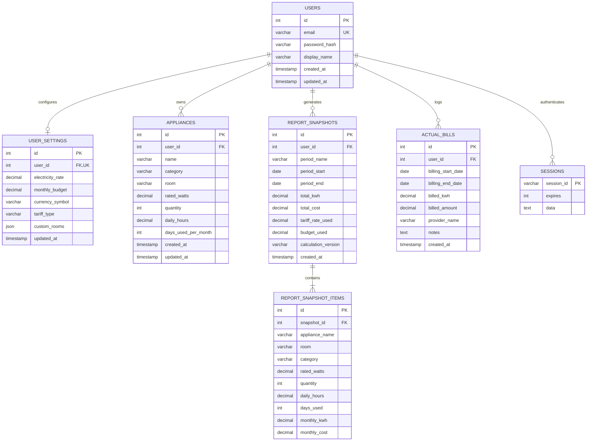

# Database Schema & Data Architecture

## Project: EnergySaver – Electricity Usage Analyzer
**Document Version:** 1.0.0  
**Engine:** MySQL 8.0+ (InnoDB)  
**Reference Document:** [docs/PRD.md](file:///c:/Users/garvi/OneDrive/Desktop/WEB%20Tech/Ai-project/docs/PRD.md) | [docs/ARCHITECTURE.md](file:///c:/Users/garvi/OneDrive/Desktop/WEB%20Tech/Ai-project/docs/ARCHITECTURE.md)

---

## 1. Schema Design Principles

1. **Strict User Ownership:** All core transactional tables maintain a `user_id` foreign key referencing `users(id)` with `ON DELETE CASCADE`.
2. **Normalized Master Data:** Current appliances and settings are stored in normalized 3NF tables without storing transient derived calculations.
3. **Immutable Historical Reporting:** Historical reports are preserved in dedicated snapshot tables (`report_snapshots` and `report_snapshot_items`). Editing or deleting current appliances **never alters historical reports**.
4. **Parameter-Ready Constraints:** Strict `CHECK` constraints on numerical ranges ($W > 0, 0 < H \le 24, 1 \le D \le 31$) guarantee data integrity at the database layer.

---

## 2. Entity-Relationship (ER) Diagram



---

## 3. Core Database Tables (DDL Specifications)

### 3.1 Table: `users`
Stores user authentication credentials and profile identity.

```sql
CREATE TABLE users (
    id INT AUTO_INCREMENT PRIMARY KEY,
    email VARCHAR(255) NOT NULL UNIQUE,
    password_hash VARCHAR(255) NOT NULL,
    display_name VARCHAR(100) NOT NULL,
    created_at TIMESTAMP DEFAULT CURRENT_TIMESTAMP,
    updated_at TIMESTAMP DEFAULT CURRENT_TIMESTAMP ON UPDATE CURRENT_TIMESTAMP,
    INDEX idx_users_email (email)
) ENGINE=InnoDB DEFAULT CHARSET=utf8mb4 COLLATE=utf8mb4_unicode_ci;
```

---

### 3.2 Table: `user_settings`
Stores household configuration, default flat rate, and monthly budget.

```sql
CREATE TABLE user_settings (
    id INT AUTO_INCREMENT PRIMARY KEY,
    user_id INT NOT NULL UNIQUE,
    electricity_rate DECIMAL(8, 4) NOT NULL DEFAULT 8.0000, -- Rate per kWh (up to 4 decimal places)
    monthly_budget DECIMAL(10, 2) NOT NULL DEFAULT 3500.00,  -- Monthly budget in chosen currency
    currency_symbol VARCHAR(10) NOT NULL DEFAULT '₹',       -- Currency symbol (₹, $, €, £)
    tariff_type ENUM('flat', 'slab') NOT NULL DEFAULT 'flat',
    custom_rooms JSON NULL,                                  -- Array of user-defined room strings
    updated_at TIMESTAMP DEFAULT CURRENT_TIMESTAMP ON UPDATE CURRENT_TIMESTAMP,
    CONSTRAINT fk_user_settings_user FOREIGN KEY (user_id) REFERENCES users(id) ON DELETE CASCADE,
    CONSTRAINT chk_positive_rate CHECK (electricity_rate > 0),
    CONSTRAINT chk_positive_budget CHECK (monthly_budget >= 0)
) ENGINE=InnoDB DEFAULT CHARSET=utf8mb4 COLLATE=utf8mb4_unicode_ci;
```

---

### 3.3 Table: `appliances`
Stores the active inventory of electrical appliances owned by a user's household.

```sql
CREATE TABLE appliances (
    id INT AUTO_INCREMENT PRIMARY KEY,
    user_id INT NOT NULL,
    name VARCHAR(100) NOT NULL,
    category VARCHAR(50) NOT NULL,                           -- Lighting, Heating, Cooling, Kitchen, etc.
    room VARCHAR(50) NOT NULL,                               -- Living Room, Bedroom, Kitchen, etc.
    rated_watts DECIMAL(8, 2) NOT NULL,                      -- Power in Watts (1W to 10,000W)
    quantity INT NOT NULL DEFAULT 1,                         -- Number of identical units (1 to 50)
    daily_hours DECIMAL(4, 2) NOT NULL,                      -- Average hours per day (0.10 to 24.00)
    days_used_per_month INT NOT NULL DEFAULT 30,             -- Days used in a standard month (1 to 31)
    created_at TIMESTAMP DEFAULT CURRENT_TIMESTAMP,
    updated_at TIMESTAMP DEFAULT CURRENT_TIMESTAMP ON UPDATE CURRENT_TIMESTAMP,
    CONSTRAINT fk_appliances_user FOREIGN KEY (user_id) REFERENCES users(id) ON DELETE CASCADE,
    CONSTRAINT chk_appliance_watts CHECK (rated_watts > 0 AND rated_watts <= 10000),
    CONSTRAINT chk_appliance_qty CHECK (quantity >= 1 AND quantity <= 50),
    CONSTRAINT chk_appliance_hours CHECK (daily_hours >= 0.1 AND daily_hours <= 24.0),
    CONSTRAINT chk_appliance_days CHECK (days_used_per_month >= 1 AND days_used_per_month <= 31),
    INDEX idx_appliances_user (user_id),
    INDEX idx_appliances_room (user_id, room),
    INDEX idx_appliances_category (user_id, category)
) ENGINE=InnoDB DEFAULT CHARSET=utf8mb4 COLLATE=utf8mb4_unicode_ci;
```

---

### 3.4 Table: `report_snapshots`
Stores immutable summary records of historical monthly estimates.

```sql
CREATE TABLE report_snapshots (
    id INT AUTO_INCREMENT PRIMARY KEY,
    user_id INT NOT NULL,
    period_name VARCHAR(100) NOT NULL,                       -- e.g. "October 2026 Estimate"
    period_start DATE NOT NULL,
    period_end DATE NOT NULL,
    total_kwh DECIMAL(10, 2) NOT NULL,                       -- Frozen calculated kWh
    total_cost DECIMAL(10, 2) NOT NULL,                      -- Frozen calculated estimated bill
    tariff_rate_used DECIMAL(8, 4) NOT NULL,                 -- Tariff rate at snapshot time
    budget_used DECIMAL(10, 2) NOT NULL,                     -- Budget configured at snapshot time
    calculation_version VARCHAR(20) NOT NULL DEFAULT 'v1.0', -- Version of calculation engine
    created_at TIMESTAMP DEFAULT CURRENT_TIMESTAMP,
    CONSTRAINT fk_report_snapshots_user FOREIGN KEY (user_id) REFERENCES users(id) ON DELETE CASCADE,
    INDEX idx_reports_user_period (user_id, period_start)
) ENGINE=InnoDB DEFAULT CHARSET=utf8mb4 COLLATE=utf8mb4_unicode_ci;
```

---

### 3.5 Table: `report_snapshot_items`
Stores the individual frozen appliance records associated with an immutable snapshot.

```sql
CREATE TABLE report_snapshot_items (
    id INT AUTO_INCREMENT PRIMARY KEY,
    snapshot_id INT NOT NULL,
    appliance_name VARCHAR(100) NOT NULL,
    room VARCHAR(50) NOT NULL,
    category VARCHAR(50) NOT NULL,
    rated_watts DECIMAL(8, 2) NOT NULL,
    quantity INT NOT NULL,
    daily_hours DECIMAL(4, 2) NOT NULL,
    days_used INT NOT NULL,
    monthly_kwh DECIMAL(10, 2) NOT NULL,                     -- Frozen calculated monthly kWh
    monthly_cost DECIMAL(10, 2) NOT NULL,                    -- Frozen calculated monthly cost
    CONSTRAINT fk_snapshot_items_parent FOREIGN KEY (snapshot_id) REFERENCES report_snapshots(id) ON DELETE CASCADE,
    INDEX idx_snapshot_items_snapshot (snapshot_id)
) ENGINE=InnoDB DEFAULT CHARSET=utf8mb4 COLLATE=utf8mb4_unicode_ci;
```

---

### 3.6 Table: `actual_bills`
Stores manually logged utility bills to enable side-by-side reconciliation against estimate snapshots.

```sql
CREATE TABLE actual_bills (
    id INT AUTO_INCREMENT PRIMARY KEY,
    user_id INT NOT NULL,
    billing_start_date DATE NOT NULL,
    billing_end_date DATE NOT NULL,
    billed_kwh DECIMAL(10, 2) NOT NULL,                      -- Actual units on physical bill
    billed_amount DECIMAL(10, 2) NOT NULL,                   -- Actual currency amount billed
    provider_name VARCHAR(100) NULL,                         -- Optional utility provider name
    notes TEXT NULL,                                         -- Optional user comments
    created_at TIMESTAMP DEFAULT CURRENT_TIMESTAMP,
    CONSTRAINT fk_actual_bills_user FOREIGN KEY (user_id) REFERENCES users(id) ON DELETE CASCADE,
    CONSTRAINT chk_bill_dates CHECK (billing_end_date >= billing_start_date),
    CONSTRAINT chk_positive_billed_kwh CHECK (billed_kwh >= 0),
    CONSTRAINT chk_positive_billed_amount CHECK (billed_amount >= 0),
    INDEX idx_bills_user (user_id, billing_start_date)
) ENGINE=InnoDB DEFAULT CHARSET=utf8mb4 COLLATE=utf8mb4_unicode_ci;
```

---

### 3.7 Table: `sessions`
Managed automatically by `express-mysql-session` to store authenticated browser sessions in MySQL.

```sql
CREATE TABLE sessions (
    session_id VARCHAR(128) PRIMARY KEY,
    expires INT UNSIGNED NOT NULL,
    data MEDIUMTEXT,
    INDEX idx_sessions_expires (expires)
) ENGINE=InnoDB DEFAULT CHARSET=utf8mb4 COLLATE=utf8mb4_unicode_ci;
```

---

## 4. Later Enhancement Tables (Phase 6 Additions)

These tables are defined for the progressive tariff and advanced scheduling enhancements in Phase 6:

### 4.1 Table: `tariff_slabs` (Phase 6 Enhancement)
```sql
CREATE TABLE tariff_slabs (
    id INT AUTO_INCREMENT PRIMARY KEY,
    user_id INT NOT NULL,
    slab_order INT NOT NULL,                                 -- 1, 2, 3, etc.
    min_kwh DECIMAL(10, 2) NOT NULL,                         -- e.g. 0.00
    max_kwh DECIMAL(10, 2) NULL,                             -- NULL means no upper limit (infinity)
    rate_per_kwh DECIMAL(8, 4) NOT NULL,
    CONSTRAINT fk_tariff_slabs_user FOREIGN KEY (user_id) REFERENCES users(id) ON DELETE CASCADE,
    INDEX idx_slabs_user (user_id, slab_order)
) ENGINE=InnoDB DEFAULT CHARSET=utf8mb4 COLLATE=utf8mb4_unicode_ci;
```

### 4.2 Columns Added to `appliances` for Phase 6:
```sql
-- Phase 6 Schema Migrations:
-- ALTER TABLE appliances ADD COLUMN duty_cycle_percent DECIMAL(5, 2) DEFAULT 100.00;
-- ALTER TABLE appliances ADD COLUMN weekday_hours DECIMAL(4, 2) NULL;
-- ALTER TABLE appliances ADD COLUMN weekend_hours DECIMAL(4, 2) NULL;
-- ALTER TABLE appliances ADD COLUMN standby_watts DECIMAL(8, 2) DEFAULT 0.00;
-- ALTER TABLE appliances ADD COLUMN standby_hours DECIMAL(4, 2) DEFAULT 0.00;
```
