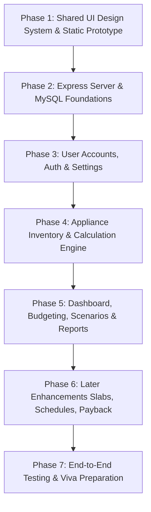

# Development Roadmap & Implementation Phases

## Project: EnergySaver – Electricity Usage Analyzer
**Document Version:** 1.0.0  
**Reference Document:** [docs/PRD.md](file:///c:/Users/garvi/OneDrive/Desktop/WEB%20Tech/Ai-project/docs/PRD.md) | [docs/FEATURES.md](file:///c:/Users/garvi/OneDrive/Desktop/WEB%20Tech/Ai-project/docs/FEATURES.md)

---

## 1. Roadmap Overview & Phasing Strategy

To keep development manageable and realistic as a student project, implementation proceeds through seven structured, sequential phases. 

Development begins with a **fully interactive frontend prototype** using labelled sample data. This allows the student to immediately validate the look, feel, responsive behavior, and calculation flows before wiring up the Node.js backend and MySQL database.

---

## 2. Phase-by-Phase Execution Plan

### Phase 1: Shared UI Design System & Static Prototype (Sample Data)
- **Goal:** Build the complete client-side visual design system and all 5 primary screens using vanilla HTML5, CSS3, and JavaScript, driven by mock sample data.
- **Prerequisites:** None.
- **Tasks:**
  1. Create `/public/css/variables.css`, `/public/css/base.css`, `/public/css/components.css`, and `/public/css/print.css`.
  2. Implement global navigation bar with links: `My Home`, `Appliances`, `Reports`, `Settings`.
  3. Build `/public/index.html` (Dashboard wireframe with cards, Chart.js canvas, and mock statistics).
  4. Build `/public/appliances.html` (Table, search/filter bar, preset modal, add/edit form with live preview).
  5. Build `/public/savings.html` (What-if scenario sliders and comparison table).
  6. Build `/public/reports.html` (Snapshot list, actual bill logging form, and variance table).
  7. Build `/public/settings.html` (Profile, currency, flat rate, monthly budget, and danger zone).
  8. Build `/public/login.html` and `/public/register.html`.
  9. Add mock sample data in `/public/js/` to enable full interaction testing before backend connectivity.
- **Affected Files:**
  - `public/**/*.html`
  - `public/css/**/*.css`
  - `public/js/utils/presets.js`
  - `public/js/utils/formatters.js`
- **Acceptance Checks:**
  - Layout is fully responsive from 360px mobile to 1920px desktop.
  - Modal open/close, tabs, and sliders function smoothly without console errors.
  - UI strictly reflects the warm off-white and charcoal notebook aesthetic.
- **Definition of Done:** All pages render cleanly in browser with zero broken styling, clear empty states, and mock interactive controls.

---

### Phase 2: Node.js & Express Server Setup, MySQL Integration & Security
- **Goal:** Establish a secure, monolithic Node.js and Express backend with MySQL connection pooling and session storage.
- **Prerequisites:** Completion of Phase 1.
- **Tasks:**
  1. Initialize `package.json` with scripts: `start`, `dev`.
  2. Install dependencies: `express`, `mysql2`, `express-session`, `express-mysql-session`, `bcrypt`, `helmet`, `dotenv`.
  3. Create `/src/server.js` with static asset serving for `/public`.
  4. Create `/sql/schema.sql` defining all DDL tables and constraints.
  5. Implement `/src/config/database.js` with a resilient `mysql2/promise` connection pool.
  6. Configure `express-session` with MySQL session store and secure cookie settings.
  7. Add global error handling and helmet security headers middleware.
  8. Create `.env.example` with clear placeholders.
- **Affected Files:**
  - `package.json`
  - `src/server.js`
  - `src/config/database.js`
  - `src/middleware/errorHandler.js`
  - `sql/schema.sql`
  - `.env.example`
- **Acceptance Checks:**
  - `npm start` launches Express without errors.
  - Server serves `/public/index.html` at `http://localhost:3000`.
  - Database health check verifies MySQL connectivity and initializes schema.
- **Definition of Done:** Express server successfully serves frontend assets, connects to MySQL, and logs zero unhandled exceptions.

---

### Phase 3: User Accounts, Authentication & Settings
- **Goal:** Implement secure user registration, session login, logout, password change, tariff/budget configuration, and account deletion with cascade.
- **Prerequisites:** Completion of Phase 2.
- **Tasks:**
  1. Implement `POST /api/auth/register` with email validation and bcrypt hashing.
  2. Implement `POST /api/auth/login` and `POST /api/auth/logout`.
  3. Implement `GET /api/auth/me` and session guard middleware (`requireAuth`).
  4. Implement `GET /api/settings` and `PUT /api/settings` (tariff rate, currency, budget).
  5. Implement `PUT /api/auth/password` (verifying current password).
  6. Implement `POST /api/auth/delete-account` (purging all user data via cascade).
  7. Replace mock auth in `/public/js/auth.js` and `/public/js/settings.js` with live API calls.
- **Affected Files:**
  - `src/controllers/authController.js`
  - `src/controllers/settingsController.js`
  - `src/middleware/auth.js`
  - `public/js/auth.js`
  - `public/js/settings.js`
- **Acceptance Checks:**
  - New user registers, logs in, and session persists across page reloads.
  - Unauthenticated access to protected routes redirects to `/login.html`.
  - Account deletion completely purges user rows from all MySQL tables.
- **Definition of Done:** Full authentication lifecycle verified with automated tests; user settings persist and isolate per user.

---

### Phase 4: Appliance Management, Live Previews & Authoritative Calculations
- **Goal:** Implement full CRUD for appliances, editable presets catalog, client preview calculations, and the authoritative server-side calculation service.
- **Prerequisites:** Completion of Phase 3.
- **Tasks:**
  1. Build `/src/services/calculator.js` (Authoritative Daily/Monthly kWh and Flat-Rate Cost formulas).
  2. Build `/public/js/utils/calculator.js` (Exact client-side mirror for zero-latency form previews).
  3. Implement `GET /api/appliances` (with room/category filtering and sorting).
  4. Implement `POST /api/appliances` (with validation boundaries $W, Q, H, D$).
  5. Implement `PUT /api/appliances/:id` and `DELETE /api/appliances/:id` (with user ownership checks).
  6. Wire preset modal in `/public/appliances.html` to populate fields with educational badges.
  7. Wire live calculation preview to update dynamically on input changes.
- **Affected Files:**
  - `src/services/calculator.js`
  - `src/controllers/applianceController.js`
  - `public/js/appliances.js`
  - `public/js/utils/calculator.js`
- **Acceptance Checks:**
  - Adding, editing, and deleting appliances reflects immediately in database and table.
  - Cross-user editing attempts return `404 Not Found`.
  - Preview numbers perfectly match server-computed saved numbers.
- **Definition of Done:** Appliance inventory fully persisted in MySQL with active CRUD operations and validated calculations.

---

### Phase 5: Dashboard Visualizations, Budget Alerts, Savings Sandbox & Historical Reports
- **Goal:** Complete the Core Release by integrating Chart.js visualizations, budget alerts, what-if scenario modeling, immutable snapshot reports, actual bill reconciliation, and CSV export.
- **Prerequisites:** Completion of Phase 4.
- **Tasks:**
  1. Implement `GET /api/dashboard/summary` (sums, top consumer, room breakdown, budget ratio).
  2. Wire Chart.js donut chart (Room breakdown) and bar chart (Top 5 appliances) in `/public/js/dashboard.js`.
  3. Implement budget alert banners (Normal, Approaching $\ge 80\%$, Over $> 100\%$).
  4. Build What-If sandbox in `/public/js/savings.js` with client-side cloning and `POST /api/savings/apply`.
  5. Implement `POST /api/reports/snapshots` and `GET /api/reports/snapshots` (immutable historical reports).
  6. Implement `POST /api/actual-bills` and `GET /api/reports/reconcile` (side-by-side variance analysis).
  7. Implement `GET /api/reports/export-csv` with formula sanitization.
  8. Configure `/public/css/print.css` for clean PDF/paper printing.
  9. Add rule-based educational tips to dashboard.
- **Affected Files:**
  - `src/controllers/dashboardController.js`
  - `src/controllers/savingsController.js`
  - `src/controllers/reportController.js`
  - `public/js/dashboard.js`
  - `public/js/savings.js`
  - `public/js/reports.js`
  - `public/css/print.css`
- **Acceptance Checks:**
  - Modifying appliances does not alter previously saved historical report snapshots.
  - What-If scenario adjustments never overwrite saved baseline data until "Apply Changes" is clicked.
  - Actual bill comparison highlights variance with objective educational checklist.
- **Definition of Done:** Core Release 100% complete, fully functional, and demonstrable.

---

### Phase 6: Advanced Enhancements (Progressive Slabs, Duty Cycle, Payback)
- **Goal:** Implement optional advanced features for academic distinction.
- **Tasks:**
  1. Add progressive tariff slab engine with fixed charges and percentage tax.
  2. Implement duty-cycle / compressor percentage modeling for intermittent loads.
  3. Implement split weekday vs. weekend operating schedules.
  4. Implement standby power tracking without double-counting active hours.
  5. Add appliance replacement financial payback calculator.
  6. Add JSON backup export and validated restore.
  7. Implement isolated Demo Mode with pre-populated 2-BHK apartment data.
- **Affected Files:**
  - `src/services/calculator.js`
  - `src/controllers/settingsController.js`
  - `public/js/savings.js`
- **Acceptance Checks:**
  - Progressive tariff calculations charge each slice at its applicable rate.
  - Simple payback displays "Not Applicable" for non-saving replacements.
- **Definition of Done:** All enhancement modules pass test vectors and operate smoothly.

---

### Phase 7: Verification, Academic Viva Prep & Local/Server Deployment
- **Goal:** Execute comprehensive test plan, review security compliance, and prepare student demonstration materials.
- **Prerequisites:** Completion of Phase 5 (and Phase 6 if implemented).
- **Tasks:**
  1. Execute all test cases in `docs/TEST_PLAN.md`.
  2. Run cross-browser and mobile responsive checks.
  3. Rehearse the teacher demonstration script in `docs/DEMO_GUIDE.md`.
  4. Prepare answers for common viva examination questions.
  5. Verify production environment readiness according to `docs/DEPLOYMENT.md`.
- **Definition of Done:** Project is 100% verified, documented, and ready for viva examination.
