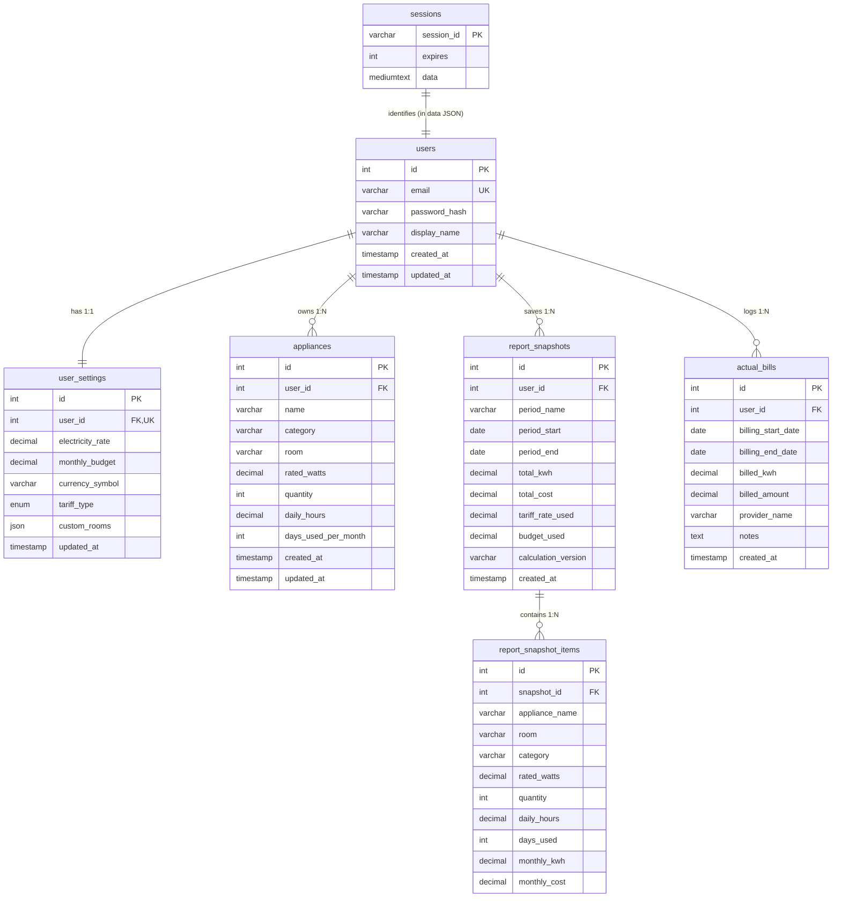

# EnergySaver — Complete REST API & Database Reference Guide
**Document:** `docs/ENERGYSAVER_API_AND_DATABASE_GUIDE.md`  
**Target Project:** EnergySaver — Electricity Usage Analyzer  
**Auditor/Author:** Full-Stack Architecture & Database Engineering Evaluator  
**Date:** November 18, 2026  
**Total Documented Endpoints:** 29 (Health/Status: 4, Auth: 7, Settings: 2, Appliances: 5, Dashboard: 1, Savings: 2, Reports & Bills: 8)  
**Total Database Tables:** 7 (`users`, `user_settings`, `appliances`, `report_snapshots`, `report_snapshot_items`, `actual_bills`, `sessions`)

---

# PART 1: MASTER REST API DIRECTORY

EnergySaver exposes 29 REST endpoints categorized into 7 functional domains. All state-mutating requests (POST, PUT, DELETE) require valid session authentication (except registration and login) and an anti-CSRF token (`X-CSRF-Token`).

| # | Method | Endpoint | Handler Function | Middleware Sequence | Auth? | CSRF? | Primary Purpose |
|:---:|:---:|:---|:---|:---|:---:|:---:|:---|
| 1 | `GET` | `/health/live` | Inline handler | None | No | No | Liveness probe returning process uptime |
| 2 | `GET` | `/health/ready` | Inline handler | None | No | No | Readiness probe testing active MySQL connectivity |
| 3 | `GET` | `/api/csrf-token` | `csrfTokenProvider` | None | No | No | Emits cryptographic anti-CSRF token bound to session |
| 4 | `GET` | `/api/status` | Inline handler | None | No | No | Application metadata & phase verification info |
| 5 | `POST` | `/api/auth/register` | `authController.register` | `csrfProtection` | No | Yes | Creates user account, settings, and session |
| 6 | `POST` | `/api/auth/login` | `authController.login` | `authRateLimiter(), csrfProtection` | No | Yes | Authenticates credentials, regenerates session ID |
| 7 | `POST` | `/api/auth/logout` | `authController.logout` | `csrfProtection` | No | Yes | Destroys MySQL session and clears cookie |
| 8 | `GET` | `/api/auth/me` | `authController.getCurrentUser` | `requireAuth` | Yes | No | Returns profile of authenticated user |
| 9 | `PUT` | `/api/auth/profile` | `authController.updateProfile` | `requireAuth, csrfProtection` | Yes | Yes | Updates user display name in MySQL `users` |
| 10 | `PUT` | `/api/auth/password` | `authController.changePassword` | `requireAuth, csrfProtection` | Yes | Yes | Verifies current password, updates bcrypt hash |
| 11 | `POST` | `/api/auth/delete-account` | `authController.deleteAccount` | `requireAuth, csrfProtection` | Yes | Yes | Cascades complete account deletion across all tables |
| 12 | `GET` | `/api/settings` | `settingsController.getSettings` | `requireAuth` | Yes | No | Fetches tariff rate, budget, and currency |
| 13 | `PUT` | `/api/settings` | `settingsController.updateSettings` | `requireAuth, csrfProtection` | Yes | Yes | Updates tariff rate, budget, and currency |
| 14 | `GET` | `/api/appliances` | `applianceController.listAppliances` | `requireAuth` | Yes | No | Lists user appliances with computed kWh and costs |
| 15 | `POST` | `/api/appliances` | `applianceController.createAppliance` | `requireAuth, csrfProtection` | Yes | Yes | Inserts new appliance (enforcing 100-item cap) |
| 16 | `PUT` | `/api/appliances/:id` | `applianceController.updateAppliance` | `requireAuth, csrfProtection` | Yes | Yes | Updates appliance attributes with ownership check |
| 17 | `DELETE` | `/api/appliances/:id` | `applianceController.deleteAppliance` | `requireAuth, csrfProtection` | Yes | Yes | Deletes appliance with ownership check |
| 18 | `POST` | `/api/appliances/preview` | `applianceController.previewAppliance` | `requireAuth, csrfProtection` | Yes | Yes | Computes stateless calculation preview |
| 19 | `GET` | `/api/dashboard/summary` | `dashboardController.getSummary` | `requireAuth` | Yes | No | Computes total bill, budget status, top appliances |
| 20 | `POST` | `/api/savings/simulate` | `savingsController.simulateSavings` | `requireAuth, csrfProtection` | Yes | Yes | Runs non-destructive What-If scenario simulation |
| 21 | `POST` | `/api/savings/apply` | `savingsController.applySavings` | `requireAuth, csrfProtection` | Yes | Yes | Updates MySQL daily_hours for confirmed savings |
| 22 | `POST` | `/api/reports/snapshots` | `reportController.saveSnapshot` | `requireAuth, csrfProtection` | Yes | Yes | Freezes current inventory into immutable snapshot |
| 23 | `GET` | `/api/reports/snapshots` | `reportController.listSnapshots` | `requireAuth` | Yes | No | Retrieves user historical snapshots |
| 24 | `GET` | `/api/reports/snapshots/:id`| `reportController.getSnapshotDetails` | `requireAuth` | Yes | No | Retrieves detailed frozen items for a snapshot |
| 25 | `POST` | `/api/actual-bills` | `reportController.logActualBill` | `requireAuth, csrfProtection` | Yes | Yes | Logs utility bill for variance comparison |
| 26 | `GET` | `/api/actual-bills` | `reportController.listActualBills` | `requireAuth` | Yes | No | Retrieves user utility bill history |
| 27 | `DELETE` | `/api/actual-bills/:id` | `reportController.deleteActualBill` | `requireAuth, csrfProtection` | Yes | Yes | Deletes logged actual utility bill |
| 28 | `GET` | `/api/reports/reconcile` | `reportController.reconcileBill` | `requireAuth` | Yes | No | Computes variance between snapshot and actual bill |
| 29 | `GET` | `/api/reports/export-csv` | `reportController.exportCsv` | `requireAuth` | Yes | No | Streams sanitized CSV file with formula defense |

---

# PART 2: ROUTE-BY-ROUTE DEEP DIVE SPECIFICATION

### Route 1: `POST /api/auth/register`
- **Description:** Creates a new user account, hashes password, inserts default settings, and initializes session.
- **Middleware Chain:** `csrfProtection`
- **Request Body:**
```json
{
  "email": "student@university.edu",
  "password": "SecurePassword123!",
  "display_name": "Aarav Patel"
}
```
- **Validation Rules:** Email must be valid format; password must be $\ge 8$ chars; display_name required ($1-100$ chars).
- **Database Queries:**
  1. `SELECT id FROM users WHERE email = ? LIMIT 1`
  2. `INSERT INTO users (email, password_hash, display_name) VALUES (?, ?, ?)`
  3. `INSERT INTO user_settings (user_id, electricity_rate, monthly_budget, currency_symbol) VALUES (?, 8.0, 3500.0, '₹')`
- **Success Response (HTTP 201 Created):**
```json
{
  "success": true,
  "message": "User registered successfully",
  "data": {
    "user": {
      "id": 1,
      "email": "student@university.edu",
      "display_name": "Aarav Patel",
      "created_at": "2026-11-18T10:00:00.000Z"
    }
  }
}
```
- **Error Responses:** HTTP 400 (Validation Error), HTTP 409 (Email Exists), HTTP 403 (Invalid CSRF).
- **Frontend Caller:** `window.EnergyApi.auth.register()` in `public/js/api.js` called by `public/js/auth.js`.

### Route 2: `POST /api/auth/login`
- **Description:** Authenticates user credentials, sets session cookie, and resets failed login attempts.
- **Middleware Chain:** `authRateLimiter(), csrfProtection`
- **Request Body:** `{ "email": "student@university.edu", "password": "SecurePassword123!" }`
- **Validation Rules:** Email and password non-empty strings.
- **Database Query:** `SELECT id, email, password_hash, display_name FROM users WHERE email = ? LIMIT 1`
- **Success Response (HTTP 200 OK):**
```json
{
  "success": true,
  "message": "Login successful",
  "data": {
    "user": {
      "id": 1,
      "email": "student@university.edu",
      "display_name": "Aarav Patel"
    }
  }
}
```
- **Error Responses:** HTTP 401 (Invalid Credentials), HTTP 429 (Rate Limit Exceeded: 5 attempts/15 min).
- **Security Feature:** Session ID is regenerated via `req.session.regenerate()` to eliminate session fixation.

### Route 3: `GET /api/appliances`
- **Description:** Retrieves all appliances belonging to the logged-in user with computed consumption metrics.
- **Middleware Chain:** `requireAuth`
- **Query Parameters:** `room` (string), `category` (string), `search` (string), `sort` (string: name, kwh, cost).
- **Database Queries:**
  1. `SELECT electricity_rate FROM user_settings WHERE user_id = ? LIMIT 1`
  2. `SELECT id, user_id, name, category, room, rated_watts, quantity, daily_hours, days_used_per_month, created_at, updated_at FROM appliances WHERE user_id = ? [AND room = ?] [AND category = ?] [AND name LIKE ?] ORDER BY ...`
- **Success Response (HTTP 200 OK):**
```json
{
  "success": true,
  "data": {
    "appliances": [
      {
        "id": 1,
        "name": "Master Bedroom Inverter AC",
        "category": "Cooling",
        "room": "Bedroom",
        "rated_watts": 1500,
        "quantity": 1,
        "daily_hours": 6,
        "days_used_per_month": 30,
        "daily_kwh": 9,
        "monthly_kwh": 270,
        "monthly_cost": 2160
      }
    ],
    "count": 1,
    "tariff_rate": 8.0
  }
}
```
- **Frontend Caller:** `window.EnergyApi.appliances.list()` in `public/js/appliances.js`.

### Route 4: `POST /api/appliances`
- **Description:** Adds a new appliance to the user's inventory in MySQL.
- **Middleware Chain:** `requireAuth, csrfProtection`
- **Request Body:**
```json
{
  "name": "Refrigerator (Double Door)",
  "category": "Kitchen",
  "room": "Kitchen",
  "rated_watts": 250,
  "quantity": 1,
  "daily_hours": 24,
  "days_used_per_month": 30
}
```
- **Validation Rules:** Watts: $1-10000$, Qty: $1-50$, Hours: $0.1-24.0$, Days: $1-31$. Max 100 appliances per user.
- **Database Query:** `INSERT INTO appliances (user_id, name, category, room, rated_watts, quantity, daily_hours, days_used_per_month) VALUES (?, ?, ?, ?, ?, ?, ?, ?)`
- **Success Response (HTTP 201 Created):** Contains inserted appliance with computed metrics.

### Route 5: `GET /api/dashboard/summary`
- **Description:** Generates aggregated consumption metrics, top consumer, room breakdown, and budget utilization.
- **Middleware Chain:** `requireAuth`
- **Database Queries:** Parallel fetch of `user_settings` and `appliances` for `req.session.userId`.
- **Success Response (HTTP 200 OK):**
```json
{
  "success": true,
  "data": {
    "total_appliances": 5,
    "total_monthly_kwh": 322.8,
    "total_monthly_cost": 2582.4,
    "total_estimated_bill": 2582.4,
    "monthly_budget": 3500.0,
    "budget_variance": 917.6,
    "budget_percentage": 73.78,
    "budget_status": "NORMAL",
    "highest_consumer": {
      "id": 2,
      "name": "Water Heater",
      "room": "Bathroom",
      "monthly_kwh": 180,
      "monthly_cost": 1440,
      "percentage": 55.76
    },
    "room_breakdown": [
      { "room": "Bathroom", "appliance_count": 1, "monthly_kwh": 180, "cost": 1440, "percentage": 55.76 },
      { "room": "Kitchen", "appliance_count": 1, "monthly_kwh": 90, "cost": 720, "percentage": 27.88 },
      { "room": "Living Room", "appliance_count": 3, "monthly_kwh": 52.8, "cost": 422.4, "percentage": 16.36 }
    ],
    "top_appliances": [...]
  }
}
```

### Route 6: `POST /api/savings/simulate`
- **Description:** Non-destructive What-If scenario simulation comparing baseline vs. proposed hours.
- **Middleware Chain:** `requireAuth, csrfProtection`
- **Request Body:** `{ "modifications": [{ "id": 1, "proposed_daily_hours": 4.5 }] }`
- **Success Response (HTTP 200 OK):** Returns `{ baseline, proposed, saved_kwh: 67.5, saved_cost: 540.0, is_savings: true }`.

### Route 7: `POST /api/reports/snapshots`
- **Description:** Freezes current inventory into an immutable snapshot with child items.
- **Middleware Chain:** `requireAuth, csrfProtection`
- **Request Body:** `{ "period_name": "October 2026", "period_start": "2026-10-01", "period_end": "2026-10-31" }`
- **Database Transaction:** Atomically inserts parent into `report_snapshots` and frozen children into `report_snapshot_items`.

### Route 8: `GET /api/reports/reconcile`
- **Description:** Compares an estimated snapshot against an actual utility bill.
- **Middleware Chain:** `requireAuth`
- **Query Parameters:** `?snapshot_id=1&bill_id=1`
- **Success Response (HTTP 200 OK):**
```json
{
  "success": true,
  "data": {
    "dates_match": true,
    "period": "2026-10-01 to 2026-10-31",
    "estimate": { "kwh": 322.8, "cost": 2582.4 },
    "actual": { "kwh": 340.0, "cost": 2720.0 },
    "variance": {
      "kwh_difference": 17.2,
      "kwh_percentage": 5.33,
      "cost_difference": 137.6,
      "cost_percentage": 5.33
    },
    "educational_checklist": [
      "Unlisted temporary appliances (e.g. festive lights, room heaters)",
      "Thermostat or compressor duty cycle differences during temperature shifts",
      "Utility provider fixed charges or meter rental fees not included in flat kWh rate"
    ]
  }
}
```

---

# PART 3: MYSQL RELATIONAL DATABASE GUIDE

## 3.1 Relational Database Fundamentals (Viva Primer)

- **RDBMS (Relational Database Management System):** Software (like MySQL 8.0) that manages data organized into tables with mathematical relations.
- **Table:** A two-dimensional grid of rows (records) and columns (attributes).
- **Primary Key (PK):** A column (e.g., `id`) that uniquely identifies every single row in a table. It cannot be NULL.
- **Foreign Key (FK):** A column in one table (e.g., `appliances.user_id`) that points to the Primary Key of another table (`users.id`), enforcing referential integrity.
- **ON DELETE CASCADE:** An automatic rule: if a parent user row is deleted from `users`, MySQL automatically purges all child records across `appliances`, `user_settings`, `report_snapshots`, and `actual_bills`.
- **CHECK Constraints:** Rules enforced by MySQL 8.0 rejecting illegal numerical ranges (e.g., `chk_appliance_hours CHECK (daily_hours >= 0.1 AND daily_hours <= 24.0)`).
- **ACID Properties:**
  - **Atomicity:** All operations in a transaction succeed, or all roll back (used in `saveSnapshot`).
  - **Consistency:** Database transitions from one valid state to another, satisfying all constraints.
  - **Isolation:** Concurrent transactions execute without interfering with one another.
  - **Durability:** Committed data is safely written to non-volatile disk storage.

---

## 3.2 Master Entity-Relationship Diagram (ERD)



---

## 3.3 Complete Data Dictionary

### Table 1: `users`
- **Purpose:** Stores user authentication identities and bcrypt password hashes.
- **Engine:** InnoDB, Charset: `utf8mb4`, Collation: `utf8mb4_unicode_ci`
- **Columns:**
  - `id` (INT, AUTO_INCREMENT, PRIMARY KEY): Unique user identifier.
  - `email` (VARCHAR(255), NOT NULL, UNIQUE, Indexed): Normalized user email.
  - `password_hash` (VARCHAR(255), NOT NULL): Salted bcrypt hash ($work factor = 10$).
  - `display_name` (VARCHAR(100), NOT NULL): User's presentation name.
  - `created_at` (TIMESTAMP, DEFAULT CURRENT_TIMESTAMP): Account registration timestamp.
  - `updated_at` (TIMESTAMP, DEFAULT CURRENT_TIMESTAMP ON UPDATE CURRENT_TIMESTAMP): Last update.

### Table 2: `user_settings`
- **Purpose:** Stores personalized tariff rates, monthly budget targets, and currency symbol.
- **Columns:**
  - `id` (INT, AUTO_INCREMENT, PRIMARY KEY): Record ID.
  - `user_id` (INT, NOT NULL, UNIQUE, FK -> users(id) ON DELETE CASCADE).
  - `electricity_rate` (DECIMAL(8,4), NOT NULL, DEFAULT 8.0000, CHECK rate > 0).
  - `monthly_budget` (DECIMAL(10,2), NOT NULL, DEFAULT 3500.00, CHECK budget >= 0).
  - `currency_symbol` (VARCHAR(10), NOT NULL, DEFAULT '₹').
  - `tariff_type` (ENUM('flat', 'slab'), NOT NULL, DEFAULT 'flat').
  - `custom_rooms` (JSON, NULL): Reserved for custom room labels.

### Table 3: `appliances`
- **Purpose:** Current active inventory of household electrical appliances.
- **Columns:**
  - `id` (INT, AUTO_INCREMENT, PRIMARY KEY).
  - `user_id` (INT, NOT NULL, FK -> users(id) ON DELETE CASCADE, Indexed).
  - `name` (VARCHAR(100), NOT NULL).
  - `category` (VARCHAR(50), NOT NULL, Indexed): Category (Cooling, Kitchen, Heating, etc.).
  - `room` (VARCHAR(50), NOT NULL, Indexed): Room (Living Room, Kitchen, Bedroom, etc.).
  - `rated_watts` (DECIMAL(8,2), NOT NULL, CHECK > 0 AND <= 10000).
  - `quantity` (INT, NOT NULL, DEFAULT 1, CHECK >= 1 AND <= 50).
  - `daily_hours` (DECIMAL(4,2), NOT NULL, CHECK >= 0.1 AND <= 24.0).
  - `days_used_per_month` (INT, NOT NULL, DEFAULT 30, CHECK >= 1 AND <= 31).

### Table 4: `report_snapshots`
- **Purpose:** Header records for immutable historical monthly estimates.
- **Columns:** `id` (PK), `user_id` (FK), `period_name`, `period_start`, `period_end`, `total_kwh`, `total_cost`, `tariff_rate_used`, `budget_used`, `calculation_version`, `created_at`.

### Table 5: `report_snapshot_items`
- **Purpose:** Child records storing frozen copies of appliances as they existed when snapshot was saved.
- **Columns:** `id` (PK), `snapshot_id` (FK -> report_snapshots(id) ON DELETE CASCADE), `appliance_name`, `room`, `category`, `rated_watts`, `quantity`, `daily_hours`, `days_used`, `monthly_kwh`, `monthly_cost`.

### Table 6: `actual_bills`
- **Purpose:** Stores actual utility provider electricity bills logged by users.
- **Columns:** `id` (PK), `user_id` (FK), `billing_start_date`, `billing_end_date`, `billed_kwh`, `billed_amount`, `provider_name`, `notes`, `created_at`.

### Table 7: `sessions`
- **Purpose:** Persistent HTTP session storage managed by `express-mysql-session`.
- **Columns:** `session_id` (VARCHAR(128) BINARY, PK), `expires` (INT UNSIGNED, Indexed), `data` (MEDIUMTEXT BINARY).

---

# PART 4: REPRESENTATIVE SQL QUERIES IN ENERGYSAVER

### Query 1: Appliance Insertion with Foreign Key
```sql
INSERT INTO appliances (
  user_id, name, category, room, rated_watts, quantity, daily_hours, days_used_per_month
) VALUES (?, ?, ?, ?, ?, ?, ?, ?);
```
- **Where Used:** `src/controllers/applianceController.js` (`createAppliance`).
- **Explanation:** Uses parameterized placeholders (`?`) to prevent SQL injection. Binds `req.session.userId` as the first parameter, ensuring that the appliance is bound to the logged-in user.

### Query 2: Secure Appliance Retrieval with Filter
```sql
SELECT id, user_id, name, category, room, rated_watts, quantity, daily_hours, days_used_per_month, created_at, updated_at
FROM appliances
WHERE user_id = ? AND room = ?
ORDER BY created_at DESC;
```
- **Where Used:** `src/controllers/applianceController.js` (`listAppliances`).
- **Explanation:** Enforces Zero-Trust IDOR protection: `user_id = ?` is mandatory. Utilizes composite index `idx_appliances_room (user_id, room)` for index-backed execution without full table scan.

### Query 3: Appliance Update with Ownership Check
```sql
UPDATE appliances 
SET name = ?, category = ?, room = ?, rated_watts = ?, quantity = ?, daily_hours = ?, days_used_per_month = ?
WHERE id = ? AND user_id = ?;
```
- **Where Used:** `src/controllers/applianceController.js` (`updateAppliance`).
- **Explanation:** Checks both `id = ?` AND `user_id = ?`. If User B attempts to pass User A's appliance ID, `affectedRows` evaluates to 0, causing the server to return HTTP 404.

### Query 4: Appliance Inventory Capping Check (DoS Defense)
```sql
SELECT COUNT(*) as total FROM appliances WHERE user_id = ?;
```
- **Where Used:** `src/controllers/applianceController.js` line 211.
- **Explanation:** Counts existing appliances for the user before permitting an insertion. If total $ge 100$, rejects with HTTP 400.

### Query 5: Snapshot Creation (Transaction Parent Insert)
```sql
INSERT INTO report_snapshots (
  user_id, period_name, period_start, period_end, total_kwh, total_cost, tariff_rate_used, budget_used, calculation_version
) VALUES (?, ?, ?, ?, ?, ?, ?, ?, 'v1.0');
```
- **Where Used:** `src/controllers/reportController.js` line 98.
- **Explanation:** Executed within an explicit MySQL transaction (`conn.beginTransaction()`). Returns `insertId` which is immediately used to insert child items.

### Query 6: Frozen Snapshot Child Item Bulk Insertion
```sql
INSERT INTO report_snapshot_items (
  snapshot_id, appliance_name, room, category, rated_watts, quantity, daily_hours, days_used, monthly_kwh, monthly_cost
) VALUES (?, ?, ?, ?, ?, ?, ?, ?, ?, ?);
```
- **Where Used:** `src/controllers/reportController.js` line 118.
- **Explanation:** Freezes the state of an appliance at the exact moment the report was saved. Even if the user deletes the appliance tomorrow, this historical row remains preserved.

### Query 7: Reconciliation Retrieval
```sql
SELECT id, period_name, DATE_FORMAT(period_start, '%Y-%m-%d') AS period_start, DATE_FORMAT(period_end, '%Y-%m-%d') AS period_end, total_kwh, total_cost 
FROM report_snapshots 
WHERE id = ? AND user_id = ? LIMIT 1;
```
- **Where Used:** `src/controllers/reportController.js` line 480.
- **Explanation:** Retrieves the snapshot while formatting dates cleanly as `YYYY-MM-DD` strings. Strictly checks `user_id = ?`.

### Query 8: Actual Bill Deletion with Ownership
```sql
DELETE FROM actual_bills WHERE id = ? AND user_id = ?;
```
- **Where Used:** `src/controllers/reportController.js` line 432.
- **Explanation:** Guarantees that users can only delete their own utility bills.

### Query 9: User Registration Duplicate Check
```sql
SELECT id FROM users WHERE email = ? LIMIT 1;
```
- **Where Used:** `src/controllers/authController.js` line 105.
- **Explanation:** Fast index lookup on `idx_users_email` to prevent duplicate account registration.

### Query 10: Complete Account Cascade Deletion
```sql
DELETE FROM users WHERE id = ?;
```
- **Where Used:** `src/controllers/authController.js` line 424.
- **Explanation:** Leveraging InnoDB `ON DELETE CASCADE` on all foreign keys, deleting this single user row automatically deletes the user's settings, appliances, snapshots, snapshot items, and actual bills in one atomic operation.
