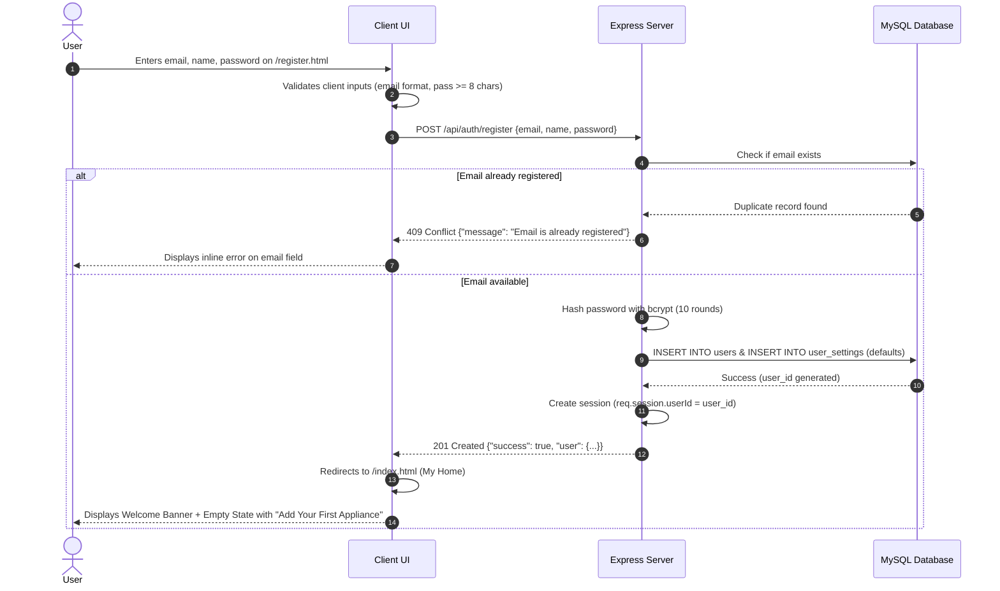
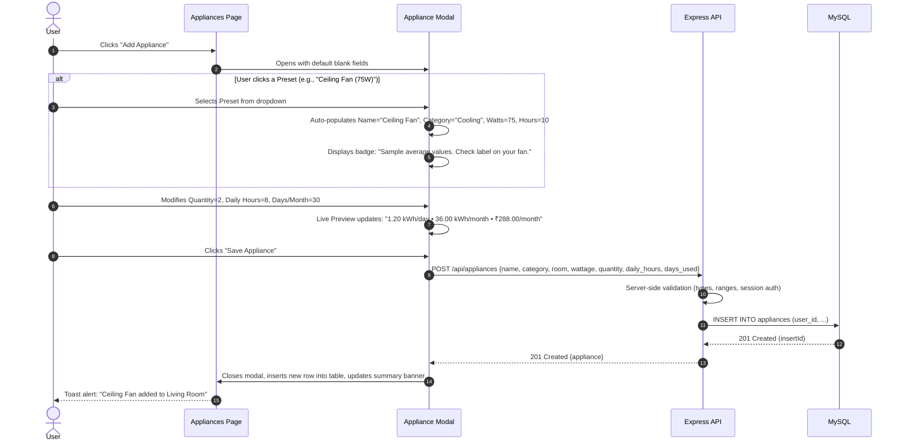
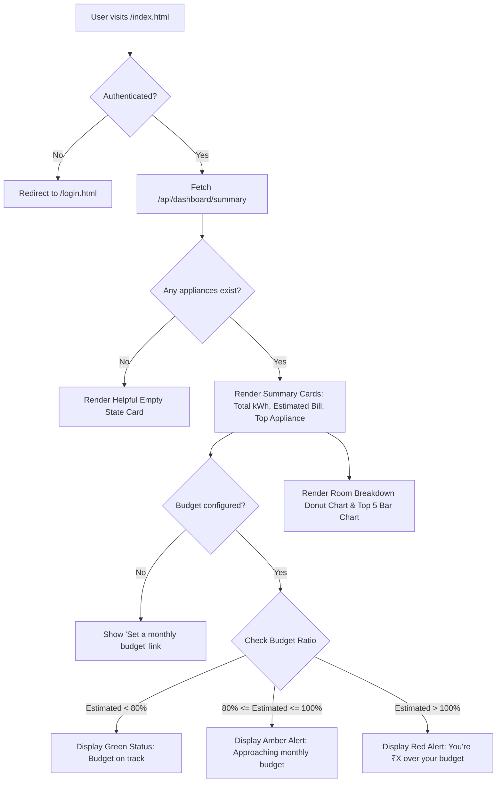
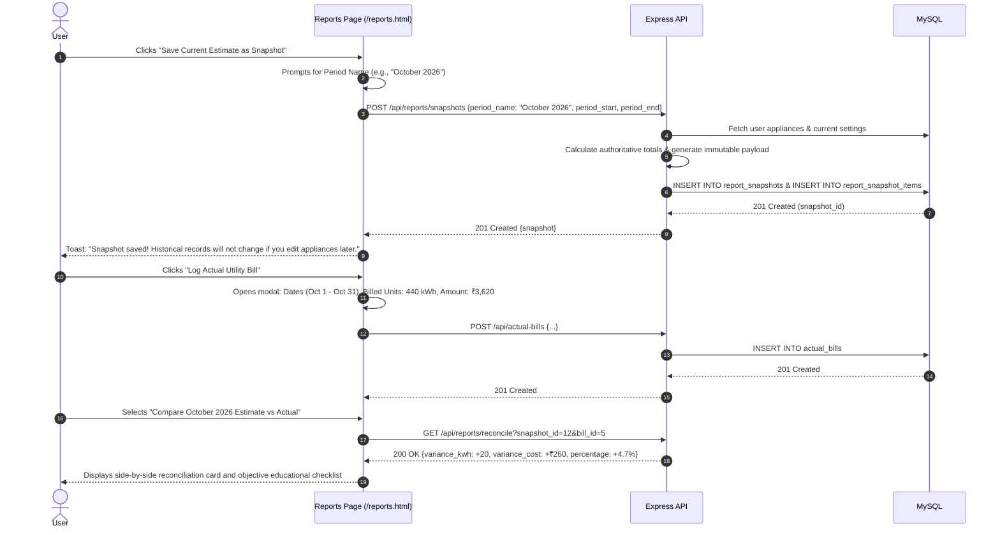

# User Flows & Interaction Workflows

## Project: EnergySaver – Electricity Usage Analyzer
**Document Version:** 1.0.0  
**Reference Document:** [docs/PRD.md](file:///c:/Users/garvi/OneDrive/Desktop/WEB%20Tech/Ai-project/docs/PRD.md) | [docs/FEATURES.md](file:///c:/Users/garvi/OneDrive/Desktop/WEB%20Tech/Ai-project/docs/FEATURES.md)

---

## 1. Flow 1: Registration, Login & First-Time Onboarding



### Detailed Steps:
1. **Entry Point:** User visits `/login.html` or `/register.html`.
2. **Input Fields:** Display Name, Email Address, Password, Confirm Password.
3. **Client Validation:** Instant visual feedback (red border + message) if passwords mismatch or password is $<8$ characters.
4. **Onboarding State:** Upon first login, user has 0 appliances. Dashboard displays a warm onboarding card:
   > *"Welcome to EnergySaver! To begin understanding your home's electricity usage, start by adding your major appliances (fans, refrigerator, geyser) or choose from common presets."*
   > **[Add Your First Appliance]** (Primary green button)

---

## 2. Flow 2: Appliance Inventory Management



### Edge Cases & Alternate Paths:
- **Validation Failure:** User inputs $0$ or negative wattage. Frontend highlights input in red: *"Wattage must be between 1 and 10,000 Watts"*. Form submission is blocked.
- **Editing Appliance:** User clicks "Edit" icon on table row. Modal loads existing appliance values. Submits `PUT /api/appliances/:id`. Backend verifies `appliance.user_id === session.userId`.
- **Deleting Appliance:** User clicks "Delete" icon. Modal asks: *"Are you sure you want to remove 'Water Heater'? This will update your monthly estimates immediately."* User confirms $\rightarrow$ `DELETE /api/appliances/:id` $\rightarrow$ Row fades out, summary metrics recalculate.

---

## 3. Flow 3: Dashboard Overview & Budget Monitoring



### Alert Wording Guidelines:
- **Approaching Budget:** *"Notice: Your estimated bill of ₹3,420 is approaching your monthly budget of ₹3,500 (97.7% of budget)."*
- **Over Budget:** *"Attention: Your estimated bill of ₹4,150 exceeds your monthly budget of ₹3,500 by ₹650. Explore the Savings Planner to find opportunities to reduce usage."*

---

## 4. Flow 4: What-If Savings Planner (Experimentation Sandbox)

```mermaid
sequenceDiagram
    autonumber
    actor User
    participant Page as Savings Page (/savings.html)
    participant Engine as Client Calculation Engine
    participant API as Express API
    participant DB as MySQL

    User->>Page: Navigates to Savings Planner
    Page->>API: GET /api/appliances (fetches saved baseline appliances)
    API-->>Page: 200 OK (Array of saved appliances)
    Page->>Page: Clones baseline into in-memory sandbox array
    User->>Page: Adjusts "Water Heater" daily hours from 1.5h to 1.0h
    Page->>Engine: recalculateScenario(sandboxAppliances)
    Engine-->>Page: Proposed kWh, Proposed Bill, Net Savings
    Page->>Page: Updates Comparison UI:
    Note over Page: Baseline: 420 kWh (₹3,360)<br/>Proposed: 397.5 kWh (₹3,180)<br/>Estimated Savings: 22.5 kWh/month (₹180.00/month)
    alt User clicks "Reset Changes"
        User->>Page: Clicks "Reset"
        Page->>Page: Restores sandbox clone from saved baseline; UI resets
    else User clicks "Apply Changes to Appliances"
        User->>Page: Clicks "Apply Changes"
        Page->>Page: Displays confirmation modal: "This will update daily operating hours for Water Heater in your saved appliances list."
        User->>Page: Confirms modal
        Page->>API: POST /api/appliances/batch-update {updates: [{id: 4, daily_hours: 1.0}]}
        API->>DB: UPDATE appliances SET daily_hours = 1.0 WHERE id = 4 AND user_id = ?
        DB-->>API: Success
        API-->>Page: 200 OK
        Page-->>User: Toast alert: "Appliances updated successfully. Your new baseline is active."
    end
```

### Safety Rule:
*Under no circumstances do sliders, input changes, or trial numbers in the Savings Planner write to the database until the user explicitly confirms the "Apply Changes to Appliances" dialog.*

---

## 5. Flow 5: Report Snapshot Generation & Actual Bill Reconciliation



---

## 6. Flow 6: User Settings, Password Change & Account Deletion

### Step-by-Step Account Deletion:
1. User navigates to `/settings.html` $\rightarrow$ scrolls to the "Danger Zone" card at the bottom.
2. User clicks red outline button: **"Delete My Account and All Data"**.
3. A modal opens with prominent cautionary styling:
   > *"Are you sure you want to delete your account? This action is permanent and cannot be undone. All your appliances, historical reports, actual bills, and settings will be permanently erased."*
4. Modal requires user to enter their current password and type the confirmation word `DELETE`.
5. User submits form $\rightarrow$ `POST /api/auth/delete-account` with `{password, confirmation: "DELETE"}`.
6. Backend verifies password hash. If verified:
   - Executes `DELETE FROM users WHERE id = ?`.
   - MySQL foreign keys with `ON DELETE CASCADE` automatically delete rows in `appliances`, `user_settings`, `report_snapshots`, `report_snapshot_items`, `actual_bills`, and active sessions in `sessions`.
7. Backend destroys session and clears cookie.
8. User is redirected to `/index.html` with a notification: *"Your account and data have been permanently removed."*
